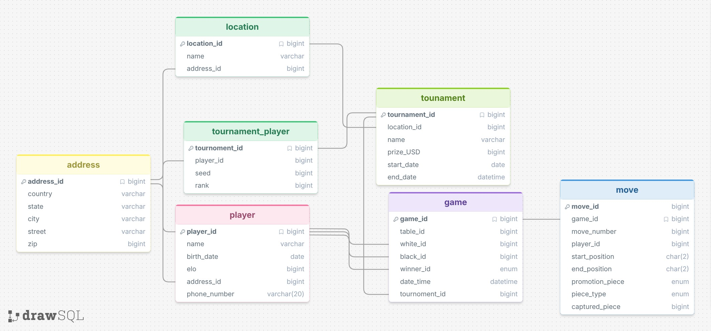

# Chess Tournament Database

This database models a small chess tournament system. It keeps track of players and their contact details, tournament venues and locations, tournament entries and rankings, games, and the moves played in each game. 



## Sample question that worked

**Question:** Which players participated in a given tournament, and what were their seeds and final ranks?

**GPT SQL response:**

```sql
SELECT
  T1.name AS player_name,
  T2.seed,
  T2.rank,
  T3.name AS tournament_name
FROM player AS T1
JOIN tournament_player AS T2
  ON T1.player_id = T2.player_id
JOIN tournament AS T3
  ON T2.tournament_id = T3.tournament_id;
```

**Friendly response:**

```text
Here are the players, their seeds, and their final ranks grouped by tournament:

**Wasatch Open**
* **Priya Patel:** Seed 3, Rank 1
* **Alice Morgan:** Seed 1, Rank 2
* **David Chen:** Seed 2, Rank 3
* **Mateo Ruiz:** Seed 4, Rank 4
* **Sofia Kim:** Seed 5, Rank 5

**Provo Summer Classic**
* **Priya Patel:** Seed 1, Rank 1
* **Nora Williams:** Seed 2, Rank 2
* **Owen Davis:** Seed 4, Rank 3
* **Ethan Brooks:** Seed 3, Rank 4

**Front Range Rapid**
* **Nora Williams:** Seed 2, Rank 1
* **Alice Morgan:** Seed 1, Rank 2
* **David Chen:** Seed 3, Rank 3
* **Sofia Kim:** Seed 4, Rank 4
```

This query joined the player, tournament entry, and tournament tables and returned the expected sample data in an easy-to-read grouping.

## Sample question that did not work as well

I did not get a completely incorrect answer in the examples I logged. One answer was accurate but too sparse to be useful on its own:

**Question:** What was the longest game in terms of moves?

**Schema-only SQL response:**

```sql
SELECT g.game_id
FROM game AS g
JOIN move AS m ON g.game_id = m.game_id
GROUP BY g.game_id
ORDER BY MAX(m.move_number) DESC
LIMIT 1;
```

**SQL result:** Game 1.

**Friendly response:** The longest game in terms of moves is game number 1!

The query found the right game, but the answer omitted how many moves it had and which tournament it belonged to. A person would need another query or more context to understand the result.

## Prompting strategies

I tried two of the three strategies discussed for the assignment: `no_shot` and `single_domain_double_shot`. The no_shot strategy gave the longest-game answer as just Game 1. With `single_domain_double_shot`, I supplied an example question and query about counting games per tournament. For the longest-game question, that strategy returned the game ID, tournament name, and move count, and explained that Game 1 from the Wasatch Open had 7 recorded moves.

That comparison suggests a relevant example can encourage a more informative query and response. This is supported by the paper included in the asignment, revieling that as we give the LLM more information and examples it preforms better.

## Other examples

The separate [examples.md](examples.md) file documents at least six more questions, their SQL, and the resulting answers. They cover tournament participation, opening moves, tournament cities, player wins, frequently moved pieces, games per tournament, the longest game, and a question about information outside the database.

I also tried the playful question “Which player has the cutest dog?” The database has no dog information, and the system said so instead of inventing an answer. The response was given in SQL query form which was not what I would have expected

## Conclusion

On this small chess dataset, the model handled straightforward joins, grouping, and counts well. The examples also show that getting the right SQL result is only part of the job: the response needs enough detail to answer the person’s question. For the longest-game question, adding a relevant example improved that context. These tests were small, but they gave me a useful starting point for exploring how prompt examples affect text-to-SQL results.
